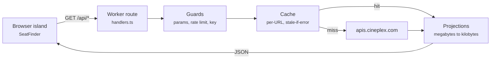

# Movie Seats

Live here: https://movie-seats.brochin5671.workers.dev

See which seats are still available for a Cineplex showtime before you book.

## Using it

Pick a theatre, then a movie, then a showtime. The page draws that auditorium with every
seat coloured by whether it is free, and marks the handful worth asking for: available,
about two thirds back, in the middle of the row, and D-BOX where the house has it.

The theatre list asks your browser for your location and puts the nearest cinema first,
with the distance beside each name. The position stays in the browser; nothing is sent
anywhere. Refuse the prompt and the list keeps the order Cineplex sent.

Above the map, a meter reads how full the house is, and a warning appears when the only
seats left are near the screen. The map refreshes itself every 30 seconds, pauses while
the tab is in the background, and can be refreshed by hand from the control beside the
word Capacity. Booking happens on Cineplex, through the link on the card.

## Running it

Requires Node 24.22.1 or newer and pnpm 11+.

You need a `CINEPLEX_API_KEY`. Cineplex runs no developer programme and issues no keys for
one, so this project ships no value and will not tell you how to obtain one. Supply your
own only if you are authorised to use it, and see [Status](#status) first. Whatever you
supply can stop working at any time, at which point every call returns 401.

```bash
pnpm install
echo 'CINEPLEX_API_KEY=<key>' > .dev.vars   # gitignored, never commit it
pnpm dev
```

Without the key the routes answer `503 upstream_unconfigured` and the page says so.
That is deliberate: an unset key is an operator problem, not an empty result.

| Command | Purpose |
|---|---|
| `pnpm dev` | Start the dev server |
| `pnpm build` | Production build |
| `pnpm preview` | Serve the production build |
| `pnpm check` | Lint and format |
| `pnpm check:types` | Type check |
| `pnpm test` | Unit and component tests |
| `pnpm test:browser` | Real-browser component tests |
| `pnpm test:e2e` | End-to-end and accessibility tests (needs a build first) |
| `pnpm preflight` | The full pipeline, in CI order |

Run `pnpm run` for the rest.

## Layout

```
src/
  components/
    custom/      the seat picker: SeatFinder and its parts
    elements/    Alert, Badge, Button, Card, Empty, Link, Meter, Popover, Skeleton
    forms/       Combobox, Field, Input, InputGroup, Label, Textarea
    layouts/     AspectRatio, Container, Grid, Main, Separator, Stack
    blocks/      Hero, used by the two error pages
    seo/         meta tags and JSON-LD
  lib/
    cineplex/    upstream calls and the projections that shrink them
    api/         shared response helpers, the cached fetch, the rate limiter
  pages/
    api/         the six internal routes the browser talks to
  styles/        global.css: design tokens and the base layer
tests/           build, e2e, integration, and shared fixtures
```

## How it works

The browser never calls Cineplex. It calls this app's own routes on the Worker, which
fetch upstream, narrow the payload to what the page needs, and cache the result. One
upstream response runs to megabytes; none of that reaches a client.



| Route | Query | Returns |
|---|---|---|
| `/api/theatres` | none | `Theatre[]`: id, name, city, coordinates |
| `/api/movies` | none | `Movie[]`: id, name, runtime, poster |
| `/api/narrow/movies` | `theatreId` | `{ filmIds }`, what plays at one theatre |
| `/api/narrow/theatres` | `filmId` | `{ theatreIds }`, where one film plays |
| `/api/showtimes` | `theatreId`, `filmId` | `Session[]`: id, auditorium, start, experiences |
| `/api/seats` | `theatreId`, `showtimeId` | `SeatMap`: rows of seats, each with a column and a state |

A missing parameter is a 400, an unset API key a 503, and an upstream failure a 502. The
shapes live in `src/lib/cineplex/types.ts`.

`src/lib/cineplex/projections.ts` is where every awkward part of the upstream format is
handled: one screening arrives once per format and is merged back, and a D-BOX block
arrives with its own row index and its own column numbering and has to be placed into the
house. It is pure and imports nothing but types, so all of that is testable against
literal fixtures with no fetch and no mocks.

An open seat map re-requests `/api/seats` every 30 seconds so it does not go stale, pauses
while the tab is hidden, and can be refreshed by hand from the control beside the capacity
label. The two seat legs are cached apart to pay for that: the auditorium's layout does not
change while a screening is on sale, so a refresh costs one upstream call rather than two.
Change the interval, or the control's cooldown, and you change what the rate limiter and the
Cineplex quota both have to absorb; `SECURITY.md` has the arithmetic.

The map names the moment it last arrived rather than how old it is, so a refresh that stops
working shows as a time that stops moving instead of a label that keeps sounding fresh.

## Status

Unofficial, and not affiliated with, endorsed by, or sponsored by Cineplex Entertainment LP.
Cineplex publishes no developer API; this reads the undocumented endpoints their own site
uses, and they can change or close them without notice. "Cineplex" and related marks belong
to their owners and appear here only to say what this interoperates with.

Cineplex's [Terms of Use](https://www.cineplex.com/policy/terms-of-use) grant a limited
licence to use their content "for non-commercial purposes which are personal or educational",
with attribution, and prohibit commercial use. That is the ceiling this project sits under,
and it is why the licence below excludes commercial use as well. Running your own copy is
your own decision and your own responsibility.

The source is under the [PolyForm Noncommercial License 1.0.0](LICENSE). That is
source-available rather than open source: the Open Source Definition does not allow a
licence to bar commercial use, so calling it open source would be wrong. Read, run, fork and
modify it for anything noncommercial.

## More

- `AGENTS.md` - the instruction file AI coding agents read before touching this repo:
  conventions, testing layers, and the library boundary. It follows the
  [agents.md](https://agents.md) convention, and a one-line `CLAUDE.md` points Claude Code at
  it so there is one source of truth rather than a copy per tool
- `CONTRIBUTING.md` - branch naming and commit format
- `SECURITY.md` - response headers, the API key, reporting
